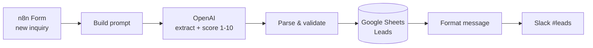
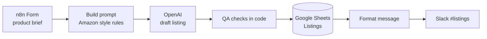
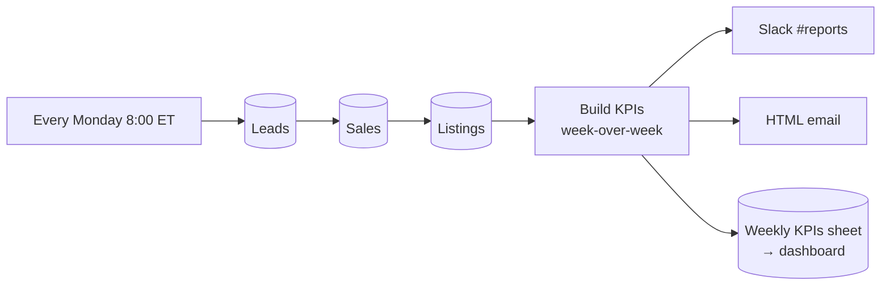

# n8n Automations for an Amazon Brand Agency

Four production-style n8n workflows that take repetitive work off an Amazon agency team:
lead handling, listing copywriting, weekly reporting, and failure alerts.

Each workflow is built the way I would run it for a client. AI output is checked in code before
anyone relies on it. Failed AI calls are retried, and the record is still saved and flagged instead
of being lost. Any failure posts an alert to Slack.

> 🎥 **Loom walkthrough:** _add link here_ · 📸 Screenshots: [`docs/screenshots`](docs/screenshots)

| # | Workflow | Replaces | Est. time saved* |
|---|----------|----------|------------------|
| 01 | [Lead Intake → AI Qualify → Sheets → Slack](#01--lead-intake--ai-qualify--google-sheets--slack) | Reading each inquiry, copying it into the CRM sheet, deciding who to call first | ~5 min/lead |
| 02 | [Product Brief → AI Amazon Listing → QA → Sheets + Slack](#02--product-brief--ai-amazon-listing--qa-checks) | Writing a first draft of a listing (title, 5 bullets, description, search terms) and checking Amazon limits | ~45 min/listing |
| 03 | [Weekly Report: Leads + Sales + Listings](#03--weekly-report-leads--amazon-sales--listings) | Pulling numbers from several sheets every Monday, calculating week-over-week, writing the update | ~1.5 h/week |
| 04 | [Error Alert → Slack](#04--error-alert--slack) | Finding out days later that an automation silently stopped | — |

\* Estimates for a team handling ~40 leads and ~10 listings a month: 3.3 h + 7.5 h + 6 h ≈ **17 hours/month**.
I measure the real numbers with the team before and after each automation goes live.

---

## 01 · Lead Intake → AI Qualify → Google Sheets → Slack



- The lead form is hosted by n8n. Its trigger can be replaced with a Webhook from a website, Typeform, or email parser.
- OpenAI returns structured JSON: category, main need, a **lead score from 1 to 10 with a reason**, and a 1–2 sentence summary.
- Slack labels each lead 🔥 hot, 🟡 warm or 🔵 cold, so sales calls the best leads first.
- **Failure handling:** OpenAI calls retry 3 times. If they still fail, the lead is **still saved** with `ai_status = needs_review`, and Slack shows ⚠️ instead of dropping it.

Code: [`src/01-lead-build-prompt.js`](src/01-lead-build-prompt.js) · [`src/01-lead-parse.js`](src/01-lead-parse.js) · [`src/01-lead-slack-message.js`](src/01-lead-slack-message.js)

## 02 · Product Brief → AI Amazon Listing → QA Checks



The AI writes the draft. **The code decides whether it is usable:**

| Check | Rule |
|-------|------|
| Title length | ≤ 200 characters |
| Bullets | exactly 5, each ≤ 250 characters |
| Description | 1,000–2,000 characters |
| Backend search terms | ≤ 249 **bytes**. Trimmed automatically, because Amazon ignores terms past the limit |
| Banned or risky words | `best`, `#1`, `guarantee`, `free shipping`, `non-toxic`, `FDA approved`, cure claims… |

The result is saved as **Ready for approval** or **Needs review** with the exact issues listed. A human still approves before anything goes live on Amazon.

Code: [`src/02-listing-build-prompt.js`](src/02-listing-build-prompt.js) · [`src/02-listing-validate.js`](src/02-listing-validate.js)

## 03 · Weekly Report: Leads + Amazon Sales + Listings



- Combines 3 sources: revenue, units, top products, new and hot leads by source, and listings drafted or needing review.
- Calculates **week-over-week change** and flags any product **down 20% or more**.
- Appends one row per week to a `Weekly KPIs` tab. A Google Sheets chart or Looker Studio dashboard reads from it.
- Empty sheets don't break the run (`alwaysOutputData`), and the report still goes out with zeros.

In production, the `Sales` tab would be filled by Amazon SP-API, a Seller Central report export, or a tool like Sellerboard. This demo uses generated sample data.

Code: [`src/03-weekly-aggregate.js`](src/03-weekly-aggregate.js)

## 04 · Error Alert → Slack

Workflows 01–03 have this workflow set as their **Error Workflow**. When any node fails, Slack `#automation-alerts` receives the workflow name, the failing node, the error message, and a link to the execution.

---

## Tech

n8n 2.x (self-hosted) · OpenAI Chat Completions (JSON mode) · Google Sheets · Slack · SMTP · JavaScript (Code nodes)

## Repo structure

```
workflows/   n8n workflow JSON, ready to import
src/         JavaScript used inside the Code nodes (readable + testable outside n8n)
scripts/     build.mjs (src → workflow JSON), deploy.mjs (push to n8n via API), generate-sample-data.mjs
sample-data/ CSVs for the Google Sheet tabs (Leads, Sales, Listings, Weekly KPIs)
docs/        setup guide and screenshots
```

Setup: see [`docs/SETUP.md`](docs/SETUP.md).
